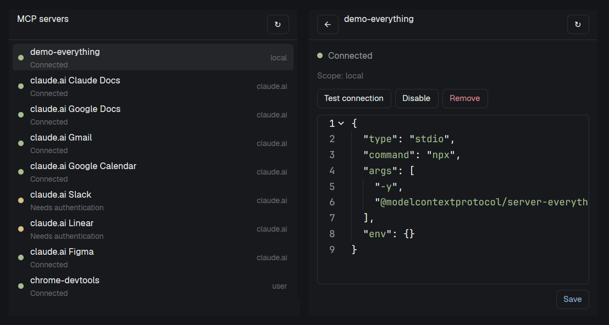

# Claude MCP

A tab-bar button that opens a side panel listing Claude Code's MCP servers for
the focused terminal's folder: each server's health at a glance, then a detail
view to edit its JSON config, enable or disable it for this folder, log in or
out (OAuth) and remove it.



## What you see

- **Tab-bar button** (layout block `mcp-toggle`, 64px wide, placed right of
  the other tab-bar buttons): a plug icon (`mark.svg`, 14px, tinted) and the
  label `MCP`, 26px high, 6px radius, 12px text. `selected` background and
  `foreground` text while the panel is open; `chrome` / `muted` otherwise;
  `hover` on hover.
- **Panel** (layout column `mcp-panel`, 420px, min 340, max 800, hidden by
  default, holding one block of the mod with no props), `surface` background:
  - Header, 44px, bottom border: title `MCP servers` (or the selected
    server's name), under it the folder in 11px `dim`; on the right a `↻`
    button, replaced by a braille spinner while loading. In the detail view a
    `←` button comes first.
  - List: one 40px row per server: an 8px status dot, the name, the status
    text under it in 11px `dim`, and the scope on the right (`claude.ai`,
    `user`, `local`, `project`, `plugin`).
  - Detail: status dot and text, `Scope: <scope>`, a wrapping row of
    28px outlined buttons, then a JSON editor (line numbers, syntax colors)
    filling the rest, with `Save` (accent text) under it. claude.ai
    connectors and plugin servers show a sentence saying where to manage them
    instead of the editor.
  - Footer message line (12px, top border) after any action: `muted`, or
    `ansi1` for errors; `<action>…` while one runs.

## How it behaves

- Status dot colors: connected `ansi2`, needs authentication `ansi3`, failed
  `ansi1`, pending approval `ansi4`, disabled `dim`.
- The panel loads once when first shown and after every action; `↻` reloads,
  also picking up a newly focused terminal's folder. Loading takes a few
  seconds (Claude Code health-checks every server).
- Clicking the button runs `layout.toggle {id: "mcp-panel"}`.
- Clicking a row opens its detail; `←` goes back.
- Buttons in the detail view:
  - `Test connection`: reloads (re-runs the health check).
  - `Enable` / `Disable`: toggles the name in
    `projects[<folder>].disabledMcpServers` of `~/.claude.json` (what
    Claude Code's `/mcp` Disable writes; the list then shows
    `⊘ Disabled for this project`).
  - `Log in` (remote servers: `http`, `sse`, a `url`, or no config):
    opens a new tab running `claude mcp login <name>` in the folder.
  - `Log out (OAuth)`: `claude mcp logout <name>`.
  - `Remove` (servers with an editable config): first click turns it
    into `Confirm removal`, second runs
    `claude mcp remove <name> -s <scope>`.
  - `Save`: parses the editor's JSON (shows `Invalid JSON: …` and
    stops if it fails), then writes it back into the scope's file.

## Built from

- One mod, two roles by `props().role`: `"toggle"` (the button) and none
  (the panel). `mod.json`: `{ "place": "none", "title": "MCP" }`, so it only
  shows where a layout puts it. Layout nodes to add:

  ```json
  { "id": "mcp-toggle", "type": "block", "content": { "mod": "claude-mcp", "props": { "role": "toggle" } }, "size": { "px": 64 } }
  ```
  ```json
  { "id": "mcp-panel", "type": "column", "size": { "px": 420 }, "min": 340, "max": 800, "hidden": true,
    "children": [{ "id": "mcp", "type": "block", "content": { "mod": "claude-mcp" } }] }
  ```

- `mcp.js` is pure logic (no Herdr imports; `node --test mcp.test.js`):
  - `parseList`: reads `claude mcp list` lines `name: target - <symbol> text`
    with `/^(.+?): .* - ([✔✘!⏸⊘]) ?(.*)$/u`; symbols map to ok, auth, failed,
    pending, disabled.
  - `configs` / `locate`: a server's scope and config, in Claude Code's
    precedence: local (`~/.claude.json` → `projects[folder].mcpServers`),
    project (`<folder>/.mcp.json` → `mcpServers`), user (`~/.claude.json` →
    `mcpServers`); names starting `claude.ai ` are connectors, anything else
    unfound comes from a plugin.
  - `setServer`, `toggleDisabled`: change the parsed file, keeping every
    other key.
- `main.js`: `exec("claude", ["mcp", …], { cwd: folder })`, `readTextFile`,
  `writeTextFile(path, text, expected)` (atomic, and refused if the file
  changed since it was read), `run("layout.toggle")`, `run("tab.new", { name,
  folder, argv })`, `layout()` (to know whether the panel is open),
  `focused()` and `spaces()` for the folder, `EditorState` / `Editor` from
  `gpui-base` for the JSON editor, `.frames()` for the spinner.
- Programs: `claude` (Claude Code CLI) on the PATH.

## Watch out

- The folder is `focused().cwd`, else the focused space's folder, else
  `home()`. `spaces().find(s => s.active)` is not the shown space: it gave
  another space's folder.
- Files are written with `JSON.stringify(doc, null, 2)`; a Claude Code
  session running at the same moment may also rewrite `~/.claude.json`. The
  `expected` argument turns that race into an error message, never a lost
  write.
- Sessions already running only see edits after `/mcp` → Reconnect; there's
  no way to reconnect a live session from outside, so there's no Reconnect
  button.
- Local machine only: a space on another machine still lists this
  computer's servers.
- `init()` skips loading when `checking()` is true.
- No "add a server" form; server names can't be renamed.

## Done when

- `herdr-app check mods/claude-mcp` passes and `node --test
  mods/claude-mcp/mcp.test.js` passes.
- The `MCP` button shows in the tab bar and toggles the panel, highlighted
  while open.
- The panel lists the same servers and statuses as `claude mcp list` run in
  the focused terminal's folder.
- Disabling a server makes it show `Disabled for this project` after reload;
  enabling restores it.
- Editing a user-scope server's JSON and saving changes `claude mcp get
  <name>`'s output.
